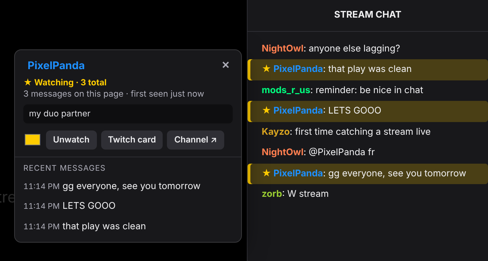
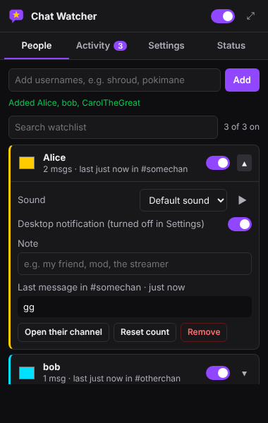
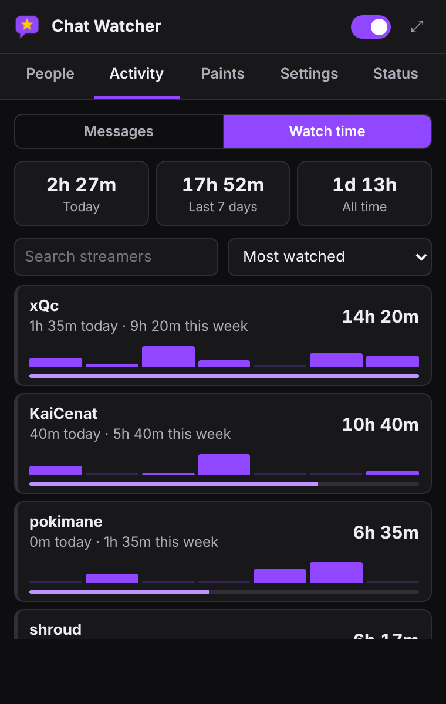
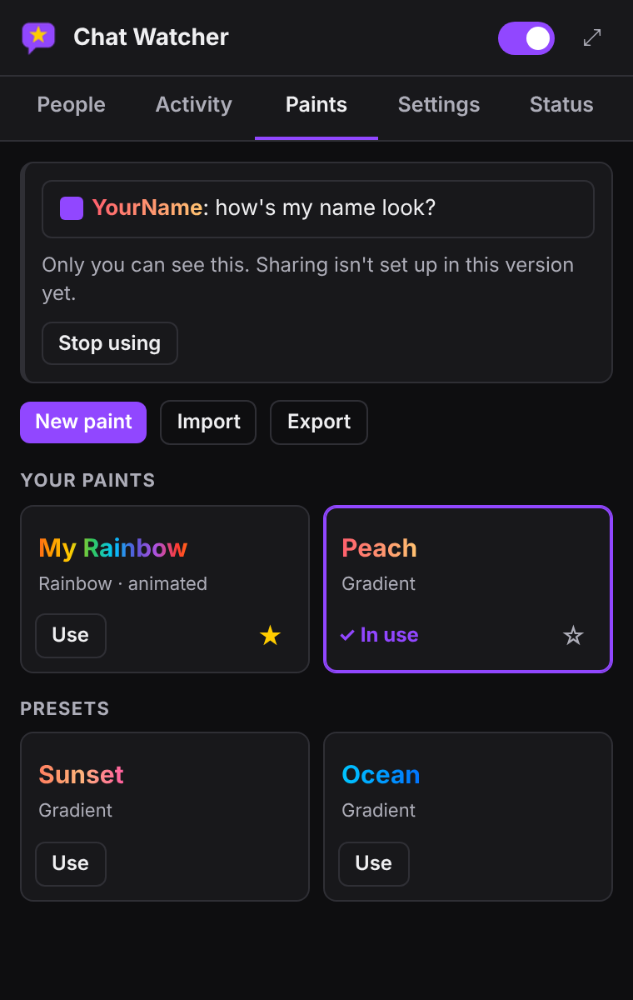
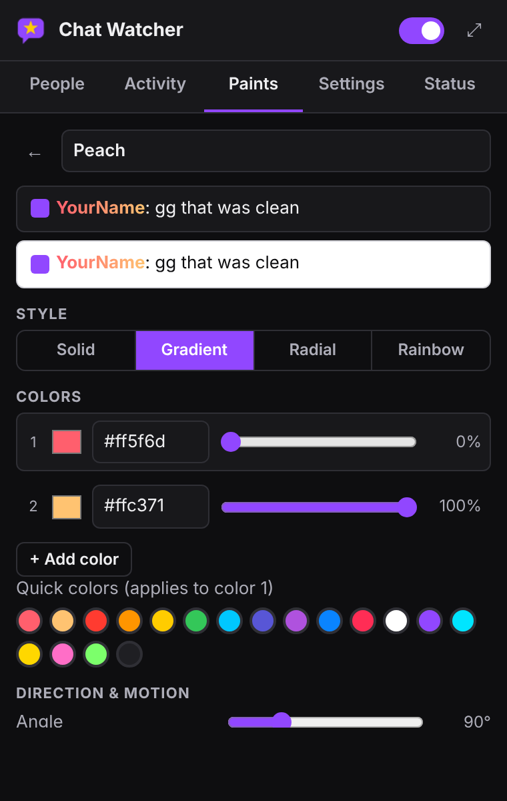

# Twitch Chat Watcher (Firefox)

Highlights a chat message and plays a sound when someone on your watchlist sends it.
Only their own messages count: if someone else @mentions or replies to them, nothing happens.

## Install

**Normal install (recommended):** go to [Releases](../../releases/latest), click the `.xpi` file, and choose **Add** when Firefox asks.
It updates itself when a new release comes out. Needs Firefox 140 or newer.

**From source (for testing changes):**
1. Download this repo and unzip it.
2. Open `about:debugging#/runtime/this-firefox`.
3. Click **Load Temporary Add-on…** and pick `manifest.json`.
4. Twitch tabs that were already open are connected automatically (no reload needed).

## Features

- **Watchlist**: add usernames, pick a highlight color, pause or remove people. Each person can have their own sound and a note.
- **Alerts**: 5 sounds, volume, cooldown per person, desktop notifications, and a flashing tab title when Twitch is in the background.
- **Profile card**: click any name (or @mention) in chat to see their recent messages, then watch them, jump to a message, or open Twitch's own card.
- **Jump to message**: click a message in the Activity tab, a profile card, or a desktop notification to scroll chat to it.
- **Firefox Sync**: your watchlist and settings follow you to other computers signed in to Firefox (with **Add-ons** sync turned on).
  Message counts and activity history stay on each computer.
- **Activity log** of everything your watchlist said, newest first.
- **Status tab** showing whether each open Twitch tab's chat is being read, plus a test button.
- Right-click any chat message, then pick **Watch this chat user**.
- Backup and restore your watchlist as a file.
- **Mention & reply alerts**: a sound (and optional desktop notification) when someone @mentions you or replies to you.
  Your Twitch name is detected automatically; change the sound or turn it off in Settings → Mentions & replies to you.
- **Watch time**: how long you've watched each streamer, shown next to the viewer count and in Activity → Watch time.
  See [Watch time](#watch-time).
- **Nametag paints** (free): give your name a solid color, gradient, radial or animated rainbow, with glow, outline and weight.
  See [Nametag paints](#nametag-paints).
- **Player**: stream delay, refresh button, audio compressor, volume boost, mono, scroll-wheel volume, volume per channel, VOD unmute.
  See [Player and audio](#player-and-audio).
- **Chat tools, moderation and auto-claim**: 7TV emotes, an emote menu, highlights, filters, deleted-message recovery and more.
  See [Chat tools](#chat-tools). They're all in the **Chat** tab.

## Player and audio

In **Chat → Player & audio**, and from the 🎚 button in the player controls:
- **Stream delay** (⏳) in the player's control bar and next to the viewer count and your watch time: how far behind the
  streamer you are, from Twitch's own player (or its Video Stats, or the buffer size if neither says). Green under 4 s, yellow under 8 s, red above. Click it to jump closer to live.
- **Audio compressor**, a reworked version of 7TV's: three presets (light, medium like 7TV, strong "night mode") with matching
  makeup gain, plus a limiter so nothing clips, and a live meter of how much it's compressing.
- **Volume boost** up to 400% for quiet streams, and **mono**.
- **Volume control**: scroll over the video to change the volume (Shift for fine steps, step size adjustable), middle-click to mute,
  with an on-screen volume readout. Twitch's own slider stays in sync.
- **Volume per channel**: each channel remembers its own volume.
- **VOD unmute**: parts of a VOD that Twitch muted play with their original audio when Twitch still has it
  (usually within about a day of the stream). Anything that's already gone falls back to the muted audio, so playback
  never breaks. Turn it off under Settings → VODs → Unmute VODs.
- **Refresh button** (⟳) in the player's control bar: reloads the stream when it freezes or keeps buffering, without
  reloading the page. VODs stay where they were. If Twitch's player can't be reached, it reloads the page instead.

Audio processing only starts once you turn on the compressor, boost or mono, and only after you've clicked the page
(browsers require that), so it can't leave a stream silent. Turning everything off again takes the processing out of the path.

## Chat tools

Everything here can be turned on or off in the **Chat** tab.

**Emotes**
- **7TV, BTTV and FFZ emotes** in chat: each channel's emotes plus the global ones, including zero-width (overlay) emotes,
  so you don't need the 7TV, BetterTTV or FrankerFaceZ extensions for emotes. When two share a name, the channel's emote wins
  (7TV, then BTTV, then FFZ). If the 7TV extension is installed too, it's left to draw its own emotes. Hover an emote for a big preview.
- **7TV personal emotes**: emotes 7TV subscribers can use in any channel show on their messages.
- **Live emote updates**: when the streamer adds or removes a 7TV or BTTV emote it changes right away, with a line in chat
  saying what changed. FFZ has no live feed, so FFZ changes show within 10 minutes.
- **Emote menu** (☺ next to Twitch's chat settings button): your favorites, recently used, your most used,
  popular in this chat, and the channel's and global 7TV emotes, with search. Click to add one to your message.
- **Favorites**: right-click any emote in chat (Favorite emote) or in the menu.
- **Usage tracking**: the emotes you send are counted (only yours, only on this computer). Your top emotes show in the menu and in the Chat tab.
- **`;` suggestions**: type `;kek` to see matching emotes (just `;` lists your most used); ↑/↓ to pick, Tab or Enter to insert.
- **Suggest emotes as you type** (optional, like 7TV): matching emotes pop up for every word without typing `;`; Tab inserts, Enter still sends.
- **Tab completion carousel**: type part of an emote name and press Tab; keep pressing Tab (or Shift+Tab) to cycle through the matches.
- **Join in on emote spam**: when several people spam the same emote (6 messages from 4 people within 10 seconds, adjustable),
  a button pops up above the chat box that sends that emote for you. Up to 3 spammed emotes show at once, and you can press
  Send as many times as you like (repeats get an invisible character so Twitch doesn't block them as duplicates).
  Nothing is ever sent without your click.
  The popup's opacity is adjustable from almost clear to solid (Chat → Emotes → Spam popup opacity); it turns solid while you hover it.
- **Bypass duplicate message check** (like 7TV): send the same message twice within 30 seconds; every other repeat gets an
  invisible character so Twitch accepts it. Skipped in emote-only chat, where Twitch would reject it.
- **Message history**: ↑/↓ in an empty chat box brings back the messages you sent in this tab.

**Highlights, filters and appearance**
- **Highlight words**: words, phrases or `/regular expressions/`, with their own color, sound, tab-title flashing and optional desktop notification.
  Matches also appear in Activity (filter "Highlighted words").
- **Highlight by badge**: broadcaster, moderators, VIPs, staff, subscribers, verified.
- **Filters**: hide (or fade) messages containing certain words, or from certain people (bots).
- **Timestamps**, text size, alternating backgrounds, lines between messages.
- **Message details**: hover a message and hold Shift (or just hover, if you prefer) for the full text, exact time, badges,
  first-time chatter and deleted status.
- **Hide shared chat**: during a Shared Chat, only show messages sent in the channel you're watching.
- Emote images are loaded lazily and decoded off the main thread.

**Deleted messages and links**
- When a moderator deletes a message or times someone out, the add-on shows what it said (crossed out if you like),
  on a red background, with links still clickable. Or hide deleted messages completely, or leave it to Twitch.
- If Twitch takes the message out of chat entirely, or never showed it (deleted within a split second, or while chat
  was paused), it's put back where it was, marked "deleted" or "timed out".
- This only works for messages the tab saw before they were removed (it can't recover anything from before you opened the channel).

**Moderation**
- **Ban and timeout lines in chat** (Twitch normally only shows these to moderators), and a **🛡 moderation panel** next to the chat box
  listing bans, timeouts, deletions and chat clears since you opened the channel.
- **Mod log**: Activity → Mod log keeps them across channels (last 500, on this computer).
- **First-time chatter** 🌱, **returning chatter** ↩ and **timed out earlier** ⚠ marks, each with its own switch.
- **When chat is cleared**: keep a copy you can expand, or let Twitch clear it.
- **If you're a moderator**: hover a message for purge / 10-minute timeout / ban buttons, and **bulk removal**
  (🛡 → Select messages…, click the messages, then purge, time out or ban their senders). These send Twitch's own
  `/timeout` and `/ban` commands through the chat box, exactly as if you typed them; bans ask first.
- **Compatibility with Twitch's mod tools**: when you're a moderator, clicking a name opens Twitch's own card,
  and filters fade messages instead of hiding them. Nothing the add-on does replaces Twitch's mod tools.

**Auto-claim**
- **Channel-points bonus**: clicks the bonus chest when it appears.
- **Moments** and **Drops**: clicks the claim button when one shows up in chat, and every Claim button on
  [twitch.tv/drops/inventory](https://www.twitch.tv/drops/inventory) while that page is open.
- Optional: **check Drops in the background** every 30 minutes while you have Twitch open (opens the inventory in a muted
  background tab, claims, and closes it).
- It only presses Twitch's own buttons, the same ones you'd click. Counts show in the Chat tab.

**How it knows about deleted messages and bans:** the add-on opens its own read-only, logged-out connection to Twitch chat
(the same kind a signed-out viewer uses) for the channels you have open. You can turn it off under Chat → Connection;
deleted-message recovery, ban/timeout lines, the moderation log, first-time chatter marks and shared-chat hiding then stop working.

Twitch changes its page from time to time. If a chat tool stops working after a Twitch update, the rest of the add-on keeps working.

## Watch time

While a stream is playing on a streamer's channel page, the add-on counts the time and shows your total (⏱) next to the
live viewer count. Hover it for today's time. **Activity → Watch time** lists every streamer you've watched, with today, last 7 days,
all-time totals and a small 7-day chart. Click a streamer to open their channel.

- Only counts while the video is actually playing (paused, ads-only pages, the directory and VOD/clip pages don't count).
- Two tabs on the same stream count once. Turn on **Only count while the tab is visible** if you don't want background tabs counted.
- Everything stays on this computer: it's never synced or sent anywhere. Export, import or reset it in **Settings → Watch time**.

Stored format, for anyone building on it (in `browser.storage.local`):
`watch = { v: 1, channels: { login: { display, total, liveTotal, first, last, sessions, days: { "YYYY-MM-DD": seconds } } } }`
and `watchSessions = [ { c: login, s: startMs, e: endMs, live } ]` (last 5,000 sessions).

## Nametag paints

 

Open the **Paints** tab. Pick a preset or press **New paint**, adjust colors and effects while watching the live preview,
then **Save & use**. Your name in chat changes right away, but only on your screen.

To let others see it, press **Publish**. A Twitch window asks you to confirm it's your account (no permissions are requested).
After that, anyone using Chat Watcher with **Show other people's paints** turned on sees your paint, usually within a few minutes.

| Who | What they see |
|---|---|
| You | Your active paint on your own name, published or not. |
| Other Chat Watcher users | Your paint, once you publish it and if they turned on "Show other people's paints". |
| People without Chat Watcher | Your normal Twitch color. Paints aren't part of Twitch. |
| 7TV users (without Chat Watcher) | Your normal color or their 7TV paint. 7TV only shows paints it hands out itself, so it can't show these. |

Viewers can hide any one person's paint from that person's profile card, turn off animation, or turn paints off entirely
(Settings → Nametag paints). Names that 7TV already painted are left alone unless you change that.

Sharing needs the paint server in `server/` to be deployed. See [server/README.md](server/README.md).
Until then, paints only show on your own screen.

## Privacy

The add-on reads chat on twitch.tv pages and keeps everything in your browser. Things leave your computer only in these cases:

- **Firefox Sync** (if you're signed in to Firefox with Add-ons sync on): your watchlist and settings. You can turn it off in Settings.
- **Publishing a paint**: your Twitch user ID, username and that one paint go to the paint server. Unpublish any time.
- **Show other people's paints** (off until you turn it on): the usernames you see in chat are sent to the paint server so it can look up their paints. Nothing else is sent: no messages, cookies or account info.
- **Connect to chat directly** (Chat tab, on by default): a logged-out, read-only connection to Twitch's chat server (`irc-ws.chat.twitch.tv`) joins the channels you have open. It never signs in and never sends messages.
- **7TV, BTTV and FFZ emotes** (Chat tab, each on by default and each can be turned off): the channel's Twitch user ID is looked up from Twitch and sent to 7TV (`7tv.io`), BetterTTV (`api.betterttv.net`) and FrankerFaceZ (`api.frankerfacez.com`) to get its emote lists. Emote images load from their servers.
- **Live emote updates and personal emotes** (on by default): the add-on keeps a connection to 7TV's event service (`events.7tv.io`) and BetterTTV's (`sockets.betterttv.net`) for the channels you have open, telling them only which channel it's watching. Nothing about you is sent.

Chat messages, your activity history, your watch time, your emote usage and the moderation log are never sent anywhere.

## If nothing happens

1. Open the **Status** tab. If it says "No Twitch chat detected", press **Connect open tabs** (or reload the Twitch tab).
2. Make sure the top switch is on and the person's switch is on.
3. If **Only these channels** has anything in it, the channel you're on must be listed.
4. Messages in the first few seconds after opening a channel are treated as history and don't beep
   (Settings → "Ignore old messages for").
5. Turn on **Debug logging** and check the Twitch tab's console (F12) for `[Chat Watcher]` lines.

## Making a release (maintainers)

1. Bump `version` in `manifest.json` and add a section to `CHANGELOG.md`.
2. Commit and push to `main`. A new version number in `manifest.json` publishes a release automatically.
3. The **Release** GitHub Action builds the add-on, has Mozilla sign it, and publishes the `.xpi` plus `updates.json`
   (which powers auto-updates) to a GitHub release.

Signing needs two repository secrets, `AMO_JWT_ISSUER` and `AMO_JWT_SECRET`. Get them from
[addons.mozilla.org → Developer Hub → Manage API Keys](https://addons.mozilla.org/developers/addon/api/key/).
Without them, the release only gets an unsigned zip. After adding the secrets, use **Actions → Release → Run workflow** to attach the signed file to the current version.
Signing is "unlisted": Mozilla signs the file, but it isn't listed publicly on addons.mozilla.org.
